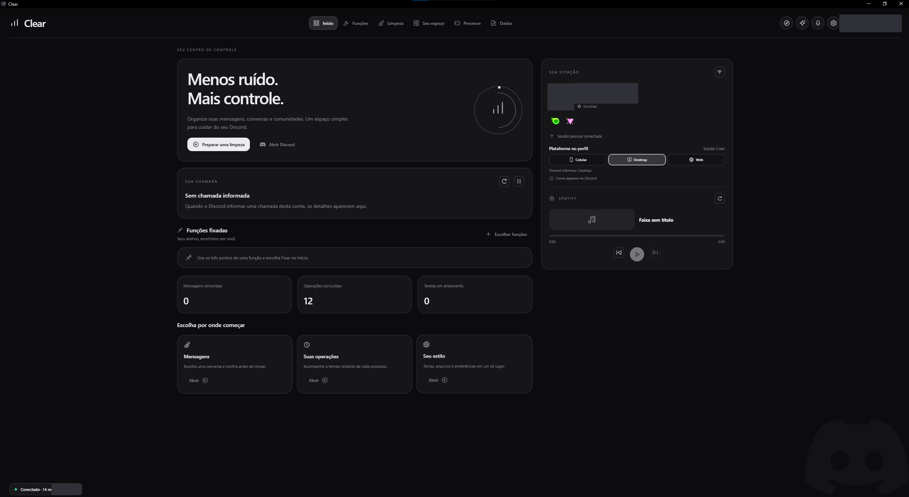
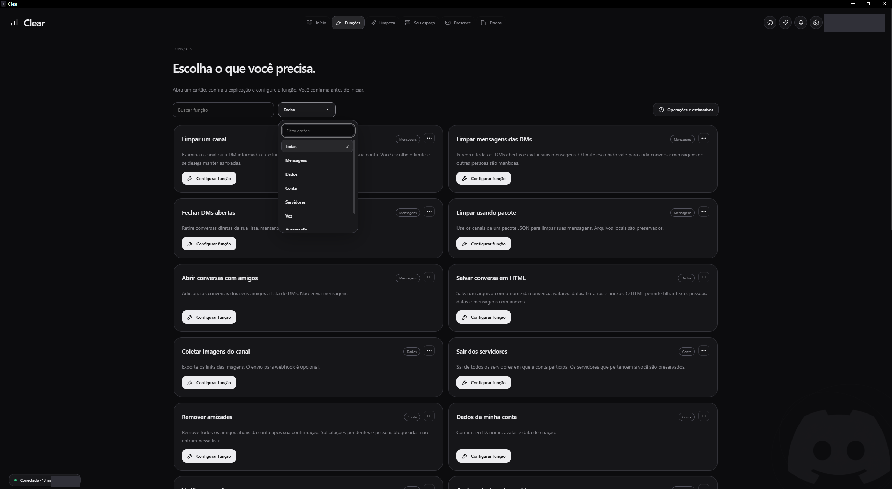
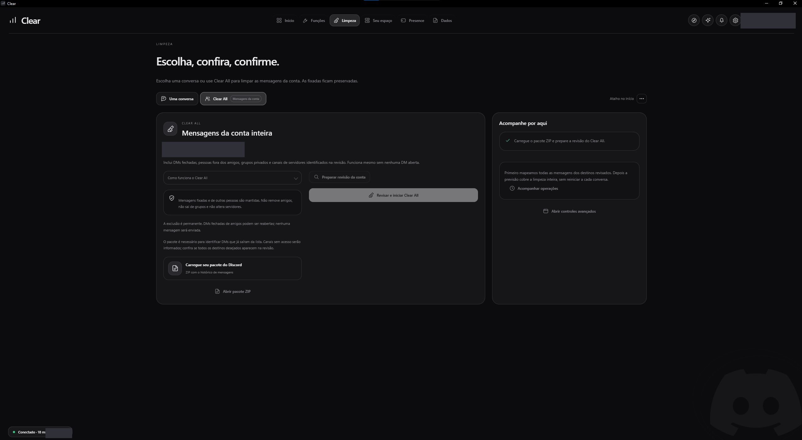
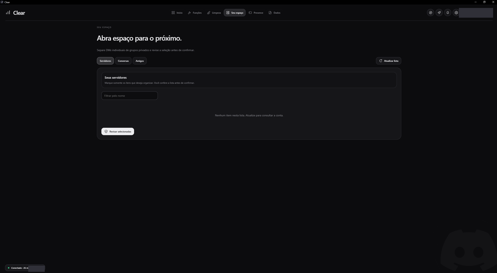
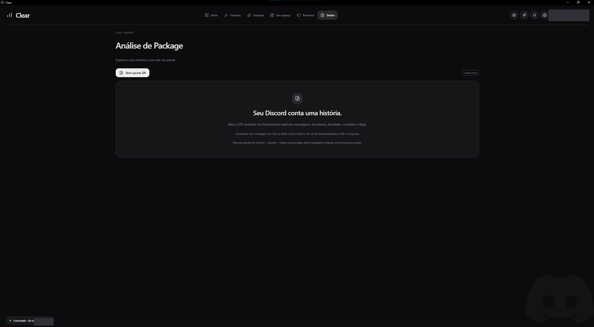
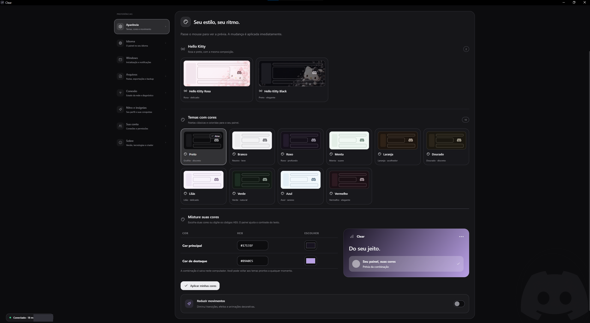
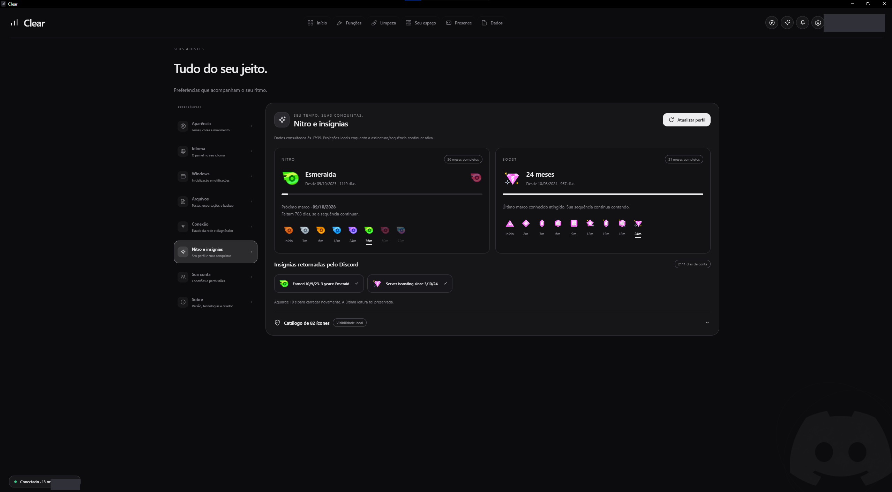

# ✨ Clear

**Painel de Clear Multi Funções para seu Discord.**

Painel independente para Windows que reúne organização de conversas, limpeza de mensagens, acompanhamento de chamadas e operações, exportações e personalização.

Este repositório disponibiliza as versões do aplicativo para download. Os fontes completos do projeto não são publicados aqui.

## 📸 Conheça a interface

Capturas reais do painel, com a identificação pessoal ocultada. Clique nas imagens para ampliar.

### 🏠 1. Início:

[](imagens/01-inicio.png)

| 🧰 2. Funções | 🧹 3. Limpeza |
| --- | --- |
| [](imagens/02-funcoes.png) | [](imagens/03-limpeza.png) |

| 🗂️ 4. Seu espaço | 📂 5. Dados e análise de pacote |
| --- | --- |
| [](imagens/04-seu-espaco.png) | [](imagens/05-dados.png) |

| 🎨 6. Temas e aparência | 💎 7. Nitro e insígnias |
| --- | --- |
| [](imagens/06-temas.png) | [](imagens/07-nitro-insignias.png) |

## 📥 Baixar:

1. 📦 Abra a seção **Releases** deste repositório.
2. Escolha a versão desejada. Versões identificadas como **Pre-release** estão em fase de testes.
3. 📥 Em **Assets**, baixe **Clear-0.18.4-Windows-x64.exe** para esta versão. Nas versões seguintes, escolha o executável com o número correspondente.
4. ▶️ Abra o arquivo baixado.

Os arquivos automáticos chamados **Source code (zip)** e **Source code (tar.gz)** contêm os arquivos deste repositório, não o aplicativo. Para usar o Clear, baixe o executável anexado à Release.

## 💻 Requisitos:

- Windows 10 ou 11 de 64 bits.
- Conexão com a internet para os recursos que acessam o Discord.
- Navegador para concluir a autorização quando esse modo de conexão for escolhido.
- Permissão de escrita nas pastas temporárias e de dados do usuário.
- Discord desktop para os recursos de integração com o cliente local, como Rich Presence.

**O Clear é portátil.** Não precisa instalar Python, Node.js, Qt ou Electron separadamente. Esses componentes acompanham o executável. Não há um assistente de instalação nesta versão.

## 🚀 Primeiro uso:

1. Abra o executável e siga a conexão oferecida pelo painel.
2. Se escolher autorizar pelo navegador, confira a conta e conclua a autorização no Discord.
3. ✅ Quando aparecer **Retorno recebido**, volte ao Clear. A confirmação da conexão acontece no próprio painel.
4. Confira os recursos disponíveis para sua forma de conexão antes de iniciar uma operação.

A conexão pelo navegador com os escopos `identify` e `guilds` permite consultar perfil e servidores. Ela, sozinha, não autoriza limpeza de DMs nem alterações na conta. Os recursos dependem do modo de conexão e dos acessos disponíveis.

## 🧰 O que o painel reúne:

- 💬 **Organização** de conversas e servidores.
- 🧹 **Limpeza de mensagens** com acompanhamento da operação, quando a conexão permite.
- 🎧 **Monitoramento de chamadas** e estados disponíveis.
- 📂 **Exportações e análise local** do pacote de dados do Discord.
- 📊 **Histórico, progresso e estimativas** das operações.
- 🎨 **Temas e personalização** da interface.

## 🔄 Atualizar:

No aplicativo, acesse **Ajustes → Sobre → Atualizações do Clear** e clique em **Ver atualizações no GitHub**. A página de Releases abrirá no seu navegador.

1. Feche a versão aberta do Clear.
2. Baixe o executável da nova Release.
3. Abra a nova versão e conecte novamente sua conta se for solicitado.

As atualizações são manuais nesta distribuição. Publicar uma Release nova não atualiza automaticamente uma cópia já baixada.

## 🔎 Conferir o download:

Quando a Release incluir **verificar-download.txt**, você pode conferir o arquivo pelo PowerShell, na pasta em que fez o download:

```powershell
# PowerShell · verificar-download · Clear para Windows · Windows · PowerShell
Get-FileHash -LiteralPath '.\Clear-0.18.4-Windows-x64.exe' -Algorithm SHA256
```

Compare o resultado com o hash publicado para o mesmo arquivo. O SHA-256 verifica se os arquivos correspondem; não é uma assinatura digital do desenvolvedor.

## 🐛 Relatar um problema:

Na seção **Issues**, informe a versão do Clear, sua versão do Windows, o recurso utilizado e os passos para reproduzir. Se houver uma mensagem de erro, inclua o texto ou uma captura com os dados pessoais ocultados.

Não publique tokens, códigos de autorização, credenciais, bancos de dados do perfil ou arquivos pessoais nos relatos.

## ⚙️ Componentes:

O Clear utiliza Electron, Python, Qt/PySide6 e Node.js. Os componentes de terceiros mantêm suas próprias licenças e avisos, incluídos na distribuição. O aplicativo também oferece a opção de consultar licenças na área **Sobre**.

Projeto independente, sem vínculo oficial com o Discord.
